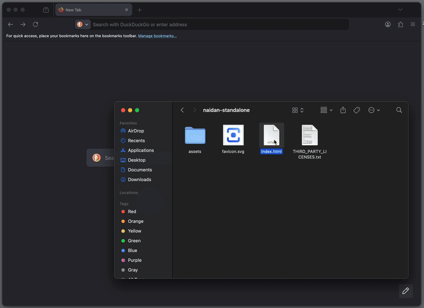

<p align="center">
  
  <h1 align="center">Naidan</h1>
</p>


> [!NOTE]
> Most of this codebase was generated by GPT, Gemini, and Claude with less human review than usual.



A privacy-focused, local-first AI app. Run models on your device, directly in your browser, or connect to OpenAI-compatible APIs and Ollama. It also runs via file://.

<https://naidan.pages.dev>

<details>
<summary>Other hosted variants</summary>

Browser-enforced [Content Security Policy (CSP)](https://developer.mozilla.org/en-US/docs/Web/HTTP/Guides/CSP) restricts external connections in two alternative hosted versions of Naidan.

## Local-only

<https://naidan-local-only.pages.dev>

This version allows connections only to Naidan's own origin and services running locally on your device.

The CSP `connect-src` directive permits:

- `'self'` (Naidan's own origin)
- `http://localhost:*`
- `http://127.0.0.1:*`

You can still connect to locally running AI servers, but features that require external services, such as downloading models from Hugging Face, may not work.

This local-only policy will remain in place as Naidan evolves.

## Curated

<https://naidan-curated.pages.dev>

In addition to the connections allowed by Local-only, this version permits a carefully selected set of external services needed by Naidan's features.

It strikes a balance between the standard hosted version and Local-only, offering more functionality while keeping external connections restricted.

Currently allowed external services include:

- Wikipedia
- Wikimedia
- Hugging Face

Access to these services is controlled by the CSP `connect-src` allowlist.

The allowlist is not fixed. We plan to expand it as Naidan evolves, carefully evaluating each new external connection.

### Note

CSP restrictions are enforced by the browser, but they do not prevent every type of network communication or eliminate all security risks.

</details>

Naidan is derived from the Japanese word for "private talk" or "confidential discussion."

## Philosophy: Why `file://`?

The core mission of this project is **radical privacy through minimal trust**.

In security, the strongest defense is to minimize the number of entities you must rely on. However, most local AI tools run as desktop applications, CLIs, or background servers (like Python scripts or Docker containers). While convenient, these native processes operate with **broad system privileges** that are difficult for users to audit or control. Unlike a web app confined to a browser sandbox, a typical desktop app or CLI generally has access to:

-   **Unrestricted File System:** Reading personal documents, SSH keys, and configuration files.
-   **System Introspection:** Monitoring running processes, installed applications, and clipboard contents.
-   **Low-Level Networking:** Establishing background connections or opening ports that evade standard browser security policies (CORS/CSP).

To us, **true serverless means no native process at all**. By running entirely inside the browser via `file://`, Naidan voluntarily accepts the browser's strict security model. It cannot access your arbitrary files or "phone home" without your explicit action.

By supporting the `file://` protocol, we achieve true accessibility and security:
- **Minimal Trust Model**: Security is transparent. You only need to trust your browser and the code within the HTML file itself. There are no opaque background server processes to audit or manage.
- **Zero Configuration**: No server setup, no command line, and no environment to manage. It is the ultimate portable application.
- **Freedom from Port Friction**: Ports are arbitrary numbers, difficult to associate with specific apps, and prone to collisions. By bypassing the server layer, we eliminate port management and the frustration of "Address already in use" errors entirely.

## Getting Started

https://github.com/user-attachments/assets/277e8469-bc11-4391-aadd-89e3384f2017

Naidan provides multiple ways to run the application, allowing you to choose the balance of convenience and control that fits your needs.

### Option 1: Standalone
Download the zip package containing the HTML file and assets, then open it directly in your browser as `file://`. No installation, no terminal, no background processes.

- **Download:** [naidan-standalone.zip](https://naidan.pages.dev/naidan-standalone.zip)
- **Mirrors:** [GitHub Releases](https://github.com/nwtgck/naidan/releases/latest) or GitHub Actions Artifacts.
- **Usage:** Unzip and just double-click `index.html`.
- **Update:** Just delete the old standalone folder and replace it with the new one. Your data is stored in your browser, so it's safe to swap versions.

### Option 2: Self-Hosted Static Files
**For those who require a standard HTTP Origin.**
Using `file://` results in `Origin: null`, which some backend CORS policies may reject. Use this optimized static build if you need a valid Origin (e.g., `http://localhost:8080`) or simply prefer using your own tools like `python3 -m http.server`, `npx serve`, or Nginx.

- **Download:** [naidan-hosted.zip](https://github.com/nwtgck/naidan/releases/latest)
- **Usage:** Serve the extracted directory with your preferred HTTP server. See [static-hosting-examples/](./static-hosting-examples/) for Nginx and Caddy configurations.
- **Update:** Replace the old files with the new version. Your data stays safely in your browser.

### Option 3: Dedicated Server Binary
A portable executable that serves the application locally without requiring Python, Node.js, or any other runtime.

- **Download:** [naidan-server](https://github.com/nwtgck/naidan/releases)
- **Update:** Replace the old binary with the new one. Your data is preserved in your browser.

### Option 4: Online Version
**Instant access with zero setup.**
Run Naidan directly from the web. Your data remains local, stored in your browser.

- https://naidan.pages.dev or https://naidan.nwtgck.org
- https://naidan-local-only.pages.dev: A hardened version with a Content-Security-Policy (CSP) that *only* allows connections to localhost APIs.
- **Update:** Just refresh the page. Your data remains in your browser.

## Key Features

- **Privacy-Focused & Local-First**: Keep your conversations and settings in your browser, with OPFS or LocalStorage for persistent storage.
- **On-Device AI**: Generate text, images, and speech on your device, directly in your browser. No inference server required.
- **Broad Compatibility**: Connect to **OpenAI-compatible APIs** (such as vLLM, LM Studio, or llama-server) and **Ollama** to use your preferred inference server.
- **Sandboxed Shell for AI Agents**: Give AI agents access to Unix-like commands, including Git, in a browser-contained environment without executing native processes or accessing arbitrary files on your device.
- **Branching**: Effortlessly fork or edit any message to create complex, tree-structured conversations without losing context.
- **Intuitive Organization**: Seamlessly manage your chats using a drag-and-drop sidebar with support for custom groups and reordering.
- **Rich Rendering**: First-class support for Markdown, LaTeX mathematical equations (KaTeX), and Mermaid diagrams.
- **Lightweight**: While Open WebUI requires a Docker image exceeding 3GB, this entire application is just a few megabytes. It's built for speed and efficiency.

## Run AI Models in Your Browser

Run AI models directly inside your browser—no inference server required. Your prompts are processed on your device, not sent to a remote model server.

### Text Generation

Choose a model to open a chat in Naidan:

- [Gemma 4 E2B it](https://naidan.pages.dev/#/?llama-cpp-browser-model=hf.co/google/gemma-4-E2B-it-qat-q4_0-gguf:Q4_0) <small>QAT Q4_0</small>
- [Gemma 4 E4B it](https://naidan.pages.dev/#/?llama-cpp-browser-model=hf.co/google/gemma-4-E4B-it-qat-q4_0-gguf:Q4_0) <small>QAT Q4_0</small>
- [Gemma 4 26B-A4B it](https://naidan.pages.dev/#/?llama-cpp-browser-model=hf.co/google/gemma-4-26B-A4B-it-qat-q4_0-gguf:Q4_0) <small>QAT Q4_0</small>
- [gpt-oss-20b](https://naidan.pages.dev/#/?llama-cpp-browser-model=hf.co/ggml-org/gpt-oss-20b-GGUF:MXFP4) <small>MXFP4</small>
- [Qwen3.5 9B](https://naidan.pages.dev/#/?llama-cpp-browser-model=hf.co/lmstudio-community/Qwen3.5-9B-GGUF:Q4_K_M) <small>Q4_K_M</small>
- [Qwen3.6 35B-A3B](https://naidan.pages.dev/#/?llama-cpp-browser-model=hf.co/ggml-org/Qwen3.6-35B-A3B-GGUF:Q4_K_M) <small>Q4_K_M</small>
- [Qwen3.8 27B](https://naidan.pages.dev/#/?llama-cpp-browser-model=hf.co/ggml-org/Qwen3.8-27B-GGUF:Q4_K_M) <small>Q4_K_M</small>
- [LFM2.5 230M](https://naidan.pages.dev/#/?llama-cpp-browser-model=hf.co/LiquidAI/LFM2.5-230M-GGUF:Q4_K_M) <small>Q4_K_M</small>
- [LFM2.5 2.6B](https://naidan.pages.dev/#/?llama-cpp-browser-model=hf.co/LiquidAI/LFM2.5-2.6B-GGUF:Q4_K_M) <small>Q4_K_M</small>
- [Muse-Glimmer 30B](https://naidan.pages.dev/#/?llama-cpp-browser-model=hf.co/meta-models/Muse-Glimmer-30B-GGUF:Q4_K_M) <small>Q4_K_M</small>
- [SmolLM2 135M Instruct](https://naidan.pages.dev/#/?llama-cpp-browser-model=hf.co/lmstudio-community/SmolLM2-135M-Instruct-GGUF:Q4_K_M) <small>Q4_K_M</small>

### Image and Audio Generation

- [Image generation](https://naidan.pages.dev/#/image-generation)
  - Z-Image-Turbo
  - Qwen Image 2.1
  - Qwen-Image-2.1-Turbo
  - Anima Turbo 1.1
  - Krea 2 Turbo
- [Audio generation](https://naidan.pages.dev/#/audio-generation)
  - Qwen3-TTS 0.6B Base
  - Qwen3-TTS 1.7B Base

  Supports voice cloning using reference audio, allowing you to generate speech in a voice of your choice.

## Cross-Tab Synchronization

https://github.com/user-attachments/assets/37c75fef-a3f7-4269-8d95-eb5f6cd01cb5

Naidan ensures that your chat history, settings, and organization stay consistent across all open tabs and windows of the application without any manual refreshing. This prevents the common frustration of "stale" tabs accidentally overwriting your latest work, allowing you to seamlessly multitask across multiple windows or monitors.

This is achieved through **serverless client-side state synchronization** using modern web standards, requiring no backend coordinator:

-   **[Web Locks API](https://developer.mozilla.org/en-US/docs/Web/API/Web_Locks_API)**: Orchestrates atomic storage operations to prevent race conditions. In environments where this API is unavailable, the application continues to operate without locks while still prioritizing data integrity.
-   **Hybrid Signaling**: Combines the **[BroadcastChannel API](https://developer.mozilla.org/en-US/docs/Web/API/BroadcastChannel)** with **LocalStorage `storage` events**. This ensures reliable real-time synchronization across tabs even in environments where some modern APIs may have restrictions.

## URL Parameters


Naidan supports URL fragment parameters (following the `#`) to automate actions or deep link into specific states. This allows you to create bookmarks or shortcuts that perform pre-defined tasks.

-   `q`: **Auto-Prompt**. Automatically creates a new chat and sends this message upon opening.
-   `model`: **Model Override**. Specifies the model ID to use for the new chat.
-   `llama-cpp-browser-model`: **Browser Model Launch**. Opens a new chat for a browser-based Hugging Face GGUF model. Accepts a Hugging Face repository reference with an optional quantization suffix (e.g., `hf.co/LiquidAI/LFM2.5-230M-GGUF:Q4_K_M`).
-   `chat-group`: **Target Group**. The name or ID of the group for the new chat. If the group doesn't exist, it is created automatically.
-   `system-prompt` (or `sp`): **System Prompt Override**. Specifies the system prompt for the new chat. This will set the chat's system behavior to `override` with the provided content.
-   `global-endpoint-type`: **Global Endpoint Type**. Specifies the type of the global endpoint (`openai` or `ollama`).
-   `global-endpoint-url`: **Global Endpoint URL**. Specifies the base URL for the global endpoint.
-   `global-model`: **Global Default Model**. Specifies the default model ID to be used globally.
-   `storage-type`: **Initial Storage Type**. Specifies the storage engine (`local`, `opfs`, or `memory`) to use. This can **only** be used for the very first initialization of the application data. If data is already present in the browser, this parameter is ignored with a notification.

### Examples

-   **Ephemeral Mode**: Start the application using in-memory storage (data is lost on refresh).
    `index.html#/?storage-type=memory`
-   **Quick Question**: Start a chat immediately with a prompt.
    `index.html#/?q=%s`
-   **Browser Model Launch**: Open a chat with a specific browser-based AI model.
    `https://naidan.pages.dev/#/?llama-cpp-browser-model=hf.co/LiquidAI/LFM2.5-230M-GGUF:Q4_K_M`
-   **Custom Behavior**: Start a chat with a specific system instruction.
    `index.html#/?sp=You+are+a+concise+assistant&q=%s`
-   **Organized Chat**: Start a chat directly inside a specific group.
    `index.html#/?chat-group=Work&q=%s`
-   **Zero-Config Setup**: Launch the app pre-configured with a specific local Ollama instance and model.
    `index.html#/?global-endpoint-type=ollama&global-endpoint-url=http://localhost:11434&global-model=llama3`

## Development

If you want to modify the code or build from source:

```bash
npm ci
npm run dev   # Start the development server
npm run build # Generates the optimized output in the dist/ directory
```
